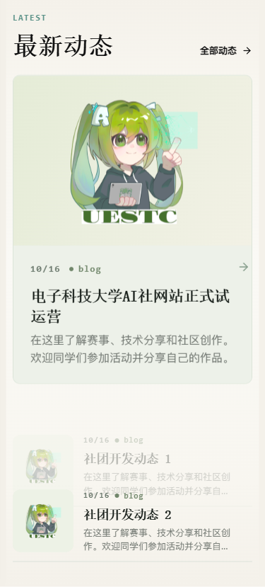
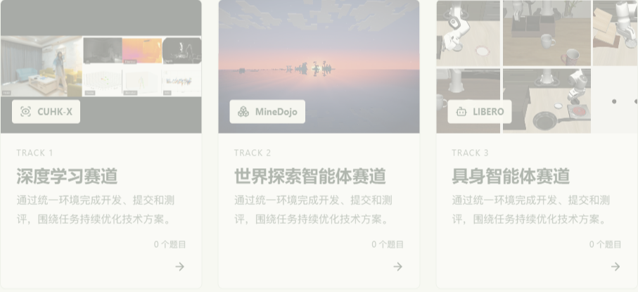
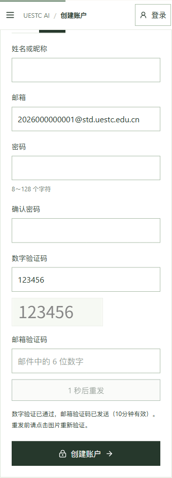

# 现存问题修复与验证（2026-10-16）

基于 `main@222fc8d` 核对并修复 #26、#27、#29—#31；#28 按用户要求暂缓。此记录为隔离环境验证，不表示已部署生产环境。

| Issue | 行为与修复 |
| --- | --- |
| #26 | 首页主资讯卡片恢复主题底色、24px 正文内边距及外层圆角；悬停不改变内部图片圆角。 |
| #27 | 两条智能体开发包新增 `CONFIG.md`，明确顶部「API 平台」入口、允许模型名、密钥注入与 `Agent.configure` 的作用；默认配置去掉未被平台解释的 `memory` 字段，保留旧包兼容。额度卡片直接展示授权模型名称。 |
| #28 | 暂缓。保持原有学生邮箱域名免邀请码规则，不收紧学号或别名格式。 |
| #29 | 参赛材料仅本队、对应赛事指定评委及管理员/组织者可读；覆盖作品列表、详情、下载、个人主页、正式指标、日志与证据。旧 `public` 附件和旧匿名 Redis 缓存不能绕过权限。社区投稿继续审核后公开。 |
| #30 | 补回赛道卡片样式类，封面固定足够高度，卡片根据可用宽度排列，手机单列。 |
| #31 | 发信后保留数字验证码图片与输入，明确标记已消费；重发前获取新挑战。错误区分数字/邮箱验证码，获取图片前提示填写有效邮箱。 |

权限与注册约束记录在 [账户与投稿说明](../deploy/linux/community-accounts.md)。无需新增数据库迁移；上线需同时更新 API、前端及两个静态开发包。匿名缓存白名单移除了作品列表、作品详情和个人主页，因此不依赖旧 Redis 条目到期。部署前按既有流程备份和切换版本。

## 验证

- 真实浏览器检查首页、赛事页在 1920、1024、390px 下的卡片尺寸、悬停状态及横向溢出；全部通过。
- 注册、找回密码在 1440、390px 下检查图片和输入保留、消费后禁用及邮箱输入可用；全部通过。
- `tests/captcha-layout.browser.cjs --expect-stable` 四组共 40 个状态检查通过，最大布局变化 0 CSS px；验证码与邮件接口均使用模拟响应，未发送真实邮件。
- 前端生产构建、TypeScript 检查与 98 项 Node 测试通过；ESLint 0 错误、2 条既有警告（`ClubVisuals.tsx` 图片、首页未使用参数）。
- 后端全量测试按模块分四个独立进程运行，共 326 项：323 通过、3 跳过、0 失败、0 异常。测试用例同时补齐了当前“一场比赛一人一队”与测评日志时限字段所需的旧夹具。
- 下载包测试比较生成包与已发布 ZIP 的全部文件内容，确认说明、配置和接口源码一致；不按 ZIP 时间戳比较。
- `tests/test_issue_regressions.py` 覆盖原有校园别名注册兼容、校外邀请规则、作品/附件/指标/日志的跨队与未分配评委拒绝、撤销评委授权，以及旧 Redis 缓存隔离。

浏览器使用虚构内容、邮箱和模拟验证码；截图不包含真实账户会话或密钥。生产构建复测采用与线上 nginx 相同的静态文件分流：`dist/client` 提供资源，Node 处理页面。

## 界面截图

首页资讯卡片（390px）：

赛道封面（1024px）：

发信后的验证码（390px）：

## 合入前复核

- 排除 #28 的邮箱格式限制及配套说明，校园别名注册规则保持原状。
- 作品接口退出浏览器内存缓存；轮询遇到权限撤销时清除旧内容，避免继续显示受限材料。
- 作品、附件与个人主页的成功和拒绝响应统一返回 `private, no-store`，并按 Cookie/Authorization 区分。
- 本次分支审查不包含其他工作区内尚未提交的缓存预取、终端或开发包改动，也不代表重新部署生产服务。

本次合入前复测：98 项前端测试、25 项核心后端测试、5 项 issue 回归及 3 项开发包检查通过；新增 `tests/work-privacy.browser.cjs` 在桌面/手机下覆盖 401、403、404 撤权后的材料与指标清除（6 组）。完整前后端 CI 在 PR 中运行后再合入。
